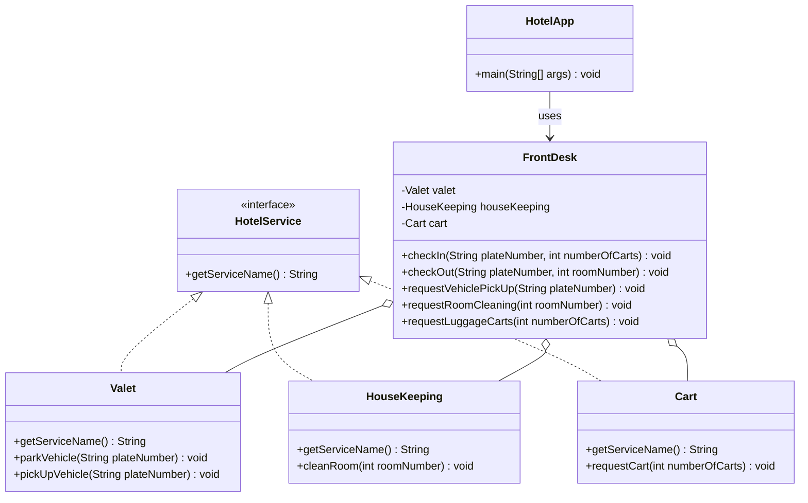

# Simplified Hotel Management System (Facade Pattern)

## Problem Statement
The HotelApp needs to manage various hotel services for guest check-in and check-out. These services include valet parking for vehicles, room cleaning, and handling luggage carts. However, the HotelApp aims to interact with these services through a simplified, single interface provided by the FrontDesk. The FrontDesk class should delegate the client's requests to the appropriate service classes (Valet, HouseKeeping, Cart) while abstracting the service details from the client.

**Class Definitions:**
- **HotelService (Interface):** Defines the common interface for all hotel services.
- **Valet:** Implements HotelService; handles vehicle valet parking and pick-up. Includes `pickUpVehicle(plateNumber)`.
- **HouseKeeping:** Implements HotelService; handles room cleaning. Includes `cleanRoom(roomNumber)`.
- **Cart:** Implements HotelService; handles luggage cart requests. Includes `requestCart(numberOfCarts)`.
- **FrontDesk:** The facade class that coordinates interactions between the client (HotelApp) and the individual hotel services.
- **HotelApp:** The client class that uses the FrontDesk facade to access hotel services.

## UML Class Diagram


## How to Run
```
cd src
javac *.java
java HotelApp
```
